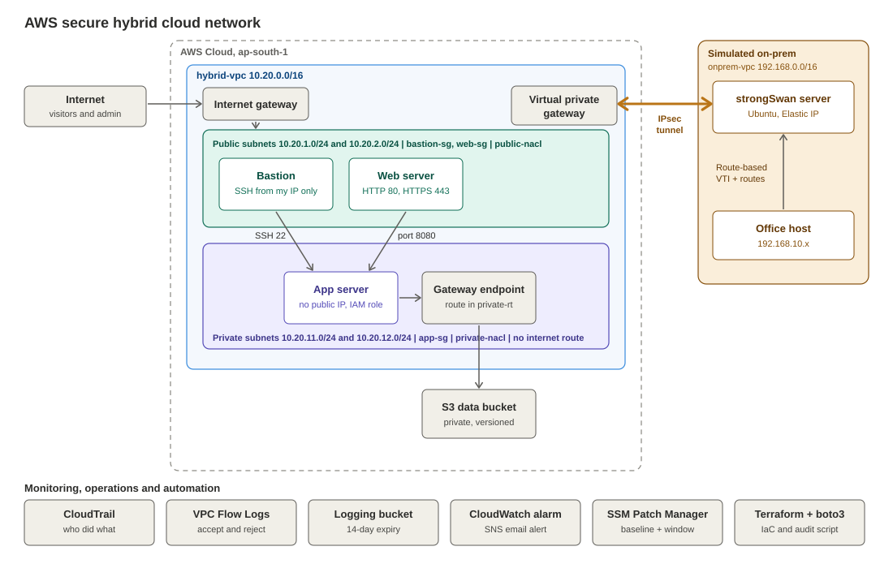

# AWS Secure Hybrid Cloud Network

A small-office style network on AWS, connected privately to a simulated on-premises site over an IPsec Site-to-Site VPN. I built it in the console, tested each part by breaking it on purpose, and rebuilt the network layer in Terraform.

## Built in two phases to control cost

**Free phase**
- VPC, public and private subnets across two availability zones, route tables, internet gateway
- Security groups and NACLs with least-privilege rules
- IAM roles on EC2 instead of access keys
- Private S3 bucket with versioning, lifecycle rule, HTTPS-only policy and a gateway VPC endpoint
- CloudTrail, VPC Flow Logs, CloudWatch alarms and SNS email alerts
- Systems Manager patch baseline and maintenance window
- Python (boto3) audit script that checks for open SSH, public S3 buckets and IAM users without MFA

**Paid phase (deleted or stopped the same day)**
- EC2 servers: bastion, web and app
- Site-to-Site VPN with a strongSwan server and an Elastic IP

## What it shows

Network design, least-privilege access, logging and monitoring, hybrid connectivity over IPsec, and automation with Python and Terraform.

## Cost

Built and tested for under $1 (about $0.88 per Cost Explorer on 1 Nov 2026), by deleting the VPN and releasing the Elastic IP the same day and stopping servers after every session.

## Architecture



## What I built

| Service | What I used it for | Why |
|---|---|---|
| VPC and subnets | `10.20.0.0/16` with public and private subnets in two AZs | Separate what the internet can reach from what it cannot |
| Internet gateway and route tables | Public route table sends `0.0.0.0/0` to the gateway | A subnet is public only because of its route table |
| Security groups | `bastion-sg`, `web-sg`, `app-sg` with group-to-group rules | Stateful, per-server least privilege |
| NACLs | `public-nacl` and `private-nacl` | A second, stateless filter at the subnet edge |
| Bastion host | The only SSH entry point, locked to my IP | Private servers need no public IP |
| IAM role and policy | Role on EC2 with a policy for one bucket | Temporary credentials, with no stored access keys |
| S3 | Private bucket with Block Public Access, versioning, lifecycle rule and an HTTPS-only deny policy | Safe storage with controlled cost |
| Gateway VPC endpoint | Route from the private subnet to S3 | Free, so no NAT gateway is needed |
| CloudTrail | Management events to a separate logging bucket | Records who did what in AWS |
| VPC Flow Logs | Filter All, to the logging bucket | Records accepted and rejected connections |
| CloudWatch, SNS, Budgets | Billing alarm and email alerts | Cost and event notification |
| Systems Manager | Patch baseline, maintenance window, target and task | Automated security patching |
| Python (boto3) | `audit.py` checks open SSH, public S3 buckets and users without MFA | Finds mistakes automatically |
| Site-to-Site VPN | Route-based IPsec tunnel to a strongSwan server in a second VPC | Hybrid connectivity to a simulated office |
| Terraform | Network layer: VPC, subnets, gateway, route tables, security groups | Repeatable build and teardown |

## Key design decisions

- **Bastion plus group-to-group rules:** `app-sg` allows SSH only from `bastion-sg` and port 8080 only from `web-sg`. The rules still work when server IPs change.
- **IAM role, not access keys:** keys are permanent and can leak. A role gives temporary credentials that rotate automatically.
- **Gateway endpoint, not NAT gateway:** the private server needs only S3. The endpoint is free, and a NAT gateway costs about $33 a month.
- **Separate logging bucket:** log services need write access, different retention and no versioning cost. Mixing them with app data breaks least privilege.
- **Deny policy for HTTP:** an explicit deny beats any allow, so the HTTPS-only rule cannot be bypassed by another policy.
- **Route-based VPN with open selectors:** the routing table decides which traffic enters the tunnel, as on a FortiGate route-based tunnel.
- **Two-phase cost plan:** free resources first, then paid ones only when needed, deleted the same day.

## What broke and how I fixed it

| Problem | What I saw | Cause and fix |
|---|---|---|
| `PutObject` denied on the app server | `AccessDenied` naming the role and action | The policy's object ARN pointed at one odd object name instead of `bucket/*`. I fixed the resource, and uploads worked. Delete stayed denied, which is least privilege. |
| STS command timed out on the private server | A hang, then a timeout | The gateway endpoint covers S3 only, and the private subnet has no internet route. Hang means no path, and `AccessDenied` means no permission. |
| SSH froze after removing a NACL rule | The session stopped responding | NACLs are stateless. The reply to my laptop goes to a high port, and it needs its own outbound rule (1024-65535). |
| CloudTrail and Flow Logs wrote to the wrong bucket | Extra statements on the data bucket, then `Access Denied` for Flow Logs | I pointed both at the data bucket by mistake. I moved them to the logging bucket and restored the data bucket policy. |
| Audit script flagged my own admin user | `IAM user ... has no MFA device` | I had left the MFA setup unfinished. I finished it, and the next run was clean. |
| CloudTrail showed actions by `root` | Event history user name | I was working as root. I created an admin IAM user with MFA. |
| strongSwan would not install | `No match for argument: strongswan` | Amazon Linux 2023 has no package for it. I used Ubuntu 24.04. |
| VPN phase 2 failed | `TS_UNACCEPTABLE` after IKE phase 1 came up | The specific-network traffic selectors did not match. I changed both sides to `0.0.0.0/0` and used a VTI interface, so the tunnel is route-based. |

## Terraform

`main.tf` builds the network layer in `ap-south-1`: one VPC, four subnets, an internet gateway, two route tables with four associations, and three security groups (15 resources). I ran destroy and apply to confirm the rebuild, then ran the audit script against the result.

```
terraform init
terraform plan -var 'my_ip=YOUR_IP/32'
terraform apply -var 'my_ip=YOUR_IP/32'
terraform destroy -var 'my_ip=YOUR_IP/32'
```

The state file and `terraform.tfvars` are excluded with `.gitignore`. Rename `terraform-lock.txt` to `.terraform.lock.hcl` before running.

## Limits and next steps

- One server per tier and one VPN tunnel, so this is not highly available. The second AZ is prepared.
- The private server cannot reach Systems Manager. That needs interface endpoints or a NAT, which I skipped for cost.
- S3, IAM, EC2 and the VPN were built in the console, and only the network layer is in Terraform.
- Next: bring up the second tunnel and test failover, add the S3 and IAM resources to Terraform, and add Session Manager with interface endpoints.

## Repository contents

- `main.tf`: Terraform network layer
- `audit.py`: boto3 security audit script
- `architecture.svg`: architecture diagram
- `Project_Screenshots/`: evidence from each phase
